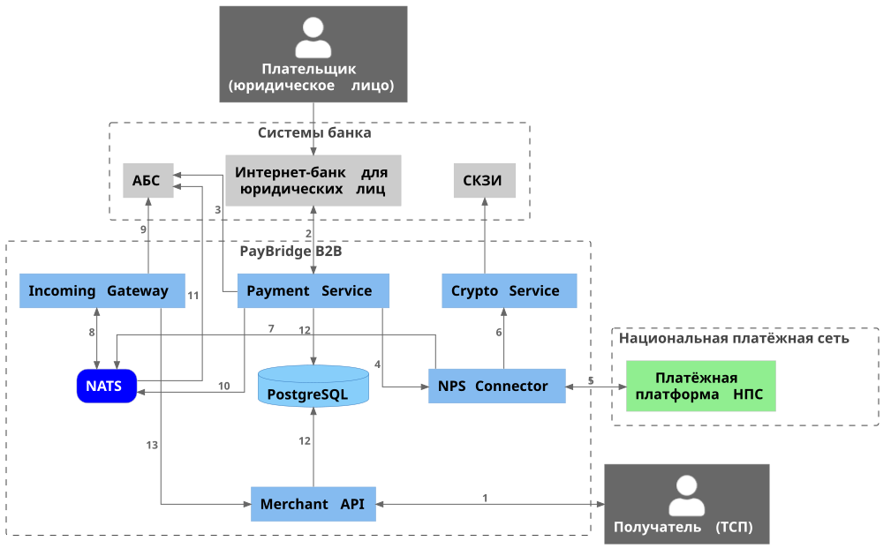

# Архитектура решения

PayBridge B2B работает в среде Docker на Linux и взаимодействует с тремя внешними участниками: системами банка, Национальной платёжной сетью (НПС) и торгово-сервисными предприятиями (ТСП).

## Потоки данных

Номера соответствуют стрелкам на схеме.

| № | Поток |
| --- | --- |
| 1 | ТСП создаёт платёжные ссылки и получает статусы через Merchant API (REST). Merchant API отправляет ТСП webhooks об оплате. |
| 2 | Интернет-банк передаёт исходящий платёж в Payment Service (REST). Payment Service отправляет интернет-банку webhooks о статусе. |
| 3 | Payment Service резервирует средства плательщика в АБС (REST, синхронно). |
| 4 | Payment Service передаёт платёж на отправку в NPS Connector. |
| 5 | NPS Connector обменивается сообщениями с НПС по ISO 20022 (`pacs.008`, `pacs.002`). |
| 6 | NPS Connector подписывает исходящие и проверяет подпись входящих сообщений через Crypto Service и СКЗИ банка. |
| 7 | NPS Connector публикует входящие платежи в NATS. |
| 8 | Incoming Gateway получает входящие платежи из NATS и публикует проводки на зачисление. |
| 9 | Incoming Gateway проверяет счёт получателя в АБС (REST, синхронно). |
| 10 | Payment Service публикует в NATS события статусов и проводки на списание. |
| 11 | АБС получает из NATS проводки на списание и зачисление (асинхронно). |
| 12 | Payment Service хранит платежи, Merchant API хранит платёжные ссылки в PostgreSQL. |
| 13 | Incoming Gateway уведомляет Merchant API об оплате ссылки. |

С АБС PayBridge работает по двум каналам: синхронные запросы по REST (резервирование средств, проверка счёта) и асинхронные проводки через NATS (списание и зачисление).

## Системы банка

| Система | Назначение |
| --- | --- |
| Интернет-банк для юридических лиц | Интерфейс плательщика: открывает платёжную ссылку, подтверждает платёж, получает статус. Вызывает Payment Service по REST API. |
| АБС | Автоматизированная банковская система: резервирует средства по запросу PayBridge, списывает и зачисляет их по проводкам. |
| СКЗИ | Сертифицированное средство криптографической защиты информации банка. Подписывает исходящие сообщения в НПС и проверяет подпись входящих. |

## Компоненты PayBridge B2B

| Компонент | Назначение |
| --- | --- |
| **Merchant API** | REST API для ТСП: создание платёжных ссылок и QR-кодов, получение статусов, возвраты. |
| **Payment Service** | Ядро обработки исходящих платежей: проверяет реквизиты, резервирует средства в АБС, ведёт статус платежа. |
| **Incoming Gateway** | Обрабатывает входящие платежи: проверяет счёт получателя и передаёт зачисление в АБС. |
| **NPS Connector** | Обмен с НПС по ISO 20022 (`pacs.008`, `pacs.002`): формирует, отправляет и принимает сообщения. |
| **Crypto Service** | Посредник между NPS Connector и СКЗИ банка: вызывает подпись и проверку подписи. |
| **Шина сообщений (NATS)** | Асинхронный обмен: входящие платежи, события статусов, проводки в АБС. |
| **PostgreSQL** | Хранение платежей, платёжных ссылок и журнала событий. |

!!! tip "Масштабирование"
    Payment Service, Incoming Gateway и Merchant API не хранят состояние в памяти и масштабируются горизонтально: достаточно увеличить число реплик сервиса. NPS Connector запускается в одном экземпляре на каждый сертификат участника НПС.
