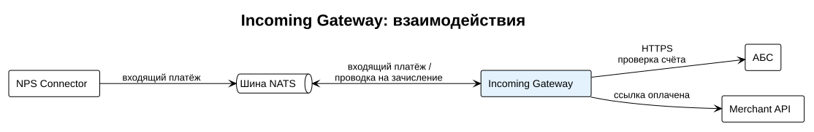

# Incoming Gateway

Incoming Gateway обрабатывает входящие B2B-платежи из НПС. Проверяет, что счёт получателя открыт в банке и активен, отвечает НПС и передаёт зачисление в АБС.



## Как работает

1. NPS Connector получает из НПС сообщение `pacs.008` и публикует платёж в шину NATS.
2. Incoming Gateway получает платёж из NATS и проверяет счёт получателя в АБС по REST.
3. Если счёт активен, шлюз подтверждает платёж, и NPS Connector отправляет в НПС `pacs.002` со статусом `ACCP`. Если счёт закрыт или не найден, шлюз отклоняет платёж с причиной `AC04` (счёт закрыт) или `AC01` (неверный номер счёта).
4. После подтверждения шлюз публикует в NATS проводку на зачисление, и АБС зачисляет средства.
5. Если платёж был оплатой по платёжной ссылке, шлюз уведомляет Merchant API, и ТСП получает webhook.

Подробная схема в разделе [Входящий платёж](../../integration/incoming.md).

## Установка

Перед установкой должны работать NATS и NPS Connector (см. [Структура решения](../structure.md)). Incoming Gateway не принимает входящих HTTP-запросов, поэтому порт наружу не публикуется.

1. Добавьте сервис в `docker-compose.yml`:

    ```yaml
    incoming-gateway:
      image: registry.example.com/paybridge/incoming-gateway:2.1.0
      restart: unless-stopped
      env_file: incoming-gateway.env
    ```

2. Заполните файл `incoming-gateway.env` (параметры в таблице ниже).
3. Запустите сервис:

    ```bash
    docker compose up -d incoming-gateway
    ```

4. [Проверьте работоспособность](#проверка-работоспособности).

## Параметры

| Параметр | Обязательный | Описание | Пример |
| --- | --- | --- | --- |
| `NATS_URL` | Да | Адрес сервера NATS. | `nats://nats:4222` |
| `ABS_URL` | Да | Адрес API АБС для проверки счёта получателя. | `https://abs.bank.local/api` |
| `ACCOUNT_CHECK_TIMEOUT_SEC` | Нет | Время ожидания ответа АБС на проверку счёта. По умолчанию `5`. | `5` |
| `LOG_LEVEL` | Нет | Уровень логирования. По умолчанию `Information`. | `Information` |

!!! note "Ограничение по времени"
    НПС ждёт ответа на входящий платёж не более 10 секунд. Значение `ACCOUNT_CHECK_TIMEOUT_SEC` должно оставлять запас на остальную обработку. Не устанавливайте его больше 7 секунд.

## Проверка работоспособности

Эндпоинт состояния доступен только внутри контейнера:

```bash
docker compose exec incoming-gateway curl -s http://localhost:8080/health
```

Ожидаемый ответ:

```json
{
  "status": "Healthy",
  "checks": { "nats": "Healthy", "abs": "Healthy" }
}
```

Если одна из проверок возвращает `Unhealthy`, проверьте соответствующий параметр подключения и сетевой доступ (см. [Сетевые доступы](../structure.md#сетевые-доступы)).
