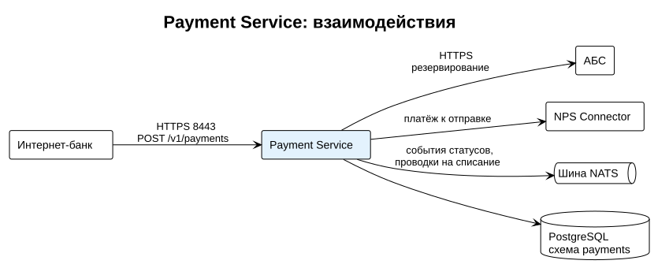

# Payment Service

Payment Service обрабатывает исходящие B2B-платежи. Принимает платёж от интернет-банка, резервирует средства в АБС, передаёт платёж в НПС через NPS Connector и ведёт его статус до финального.



Перед установкой должны работать PostgreSQL, NATS и NPS Connector (см. [Структура решения](../structure.md)).

## Установка

1. Создайте пользователя базы данных с правами на схему `payments`.
2. Добавьте сервис в `docker-compose.yml`:

    ```yaml
    payment-service:
      image: registry.example.com/paybridge/payment-service:2.1.0
      restart: unless-stopped
      ports:
        - "8443:8443"
      env_file: payment-service.env
      volumes:
        - ./certs:/app/certs:ro
    ```

3. Положите в папку `certs` TLS-сертификат и ключ сервиса (`server.crt`, `server.key`). Payment Service принимает запросы интернет-банка только по HTTPS на порту 8443.
4. Заполните файл `payment-service.env` (параметры в таблице ниже).
5. Запустите сервис:

    ```bash
    docker compose up -d payment-service
    ```

6. [Проверьте работоспособность](#проверка-работоспособности).

## Параметры

| Параметр | Обязательный | Описание | Пример |
| --- | --- | --- | --- |
| `DB_CONNECTION` | Да | Строка подключения к PostgreSQL. | `Host=db;Database=paybridge;Username=pay` |
| `NATS_URL` | Да | Адрес сервера NATS. | `nats://nats:4222` |
| `ABS_URL` | Да | Адрес API АБС для резервирования средств. Списание выполняется проводкой через NATS. | `https://abs.bank.local/api` |
| `NPS_TIMEOUT_SEC` | Нет | Время ожидания ответа НПС, после которого платёж переходит в статус `UNKNOWN`. По умолчанию `30`. | `30` |
| `WEBHOOK_RETRY_COUNT` | Нет | Число повторов отправки webhook в интернет-банк. По умолчанию `5`. | `5` |
| `LOG_LEVEL` | Нет | Уровень логирования: `Debug`, `Information`, `Warning`, `Error`. По умолчанию `Information`. | `Information` |

!!! danger "Секреты"
    Не храните пароли в `payment-service.env` в открытом виде в репозитории конфигурации. Передавайте их через Docker secrets или хранилище секретов банка.

## Проверка работоспособности

Выполните запрос к эндпоинту состояния:

```bash
curl -k https://localhost:8443/health
```

Ключ `-k` отключает проверку сертификата. Он нужен, если в тестовом контуре используется самоподписанный сертификат. В промышленном контуре выполняйте запрос без `-k`.

Ожидаемый ответ:

```json
{
  "status": "Healthy",
  "checks": { "database": "Healthy", "nats": "Healthy", "abs": "Healthy" }
}
```

Если одна из проверок возвращает `Unhealthy`, проверьте соответствующий параметр подключения и сетевой доступ (см. [Сетевые доступы](../structure.md#сетевые-доступы)).

## Логи

Сервис пишет логи в stdout в формате JSON. Каждая запись о платеже содержит поле `paymentId`, по нему удобно искать всю историю обработки одного платежа:

```bash
docker compose logs payment-service | grep '"paymentId":"pay_8f3k2"'
```
