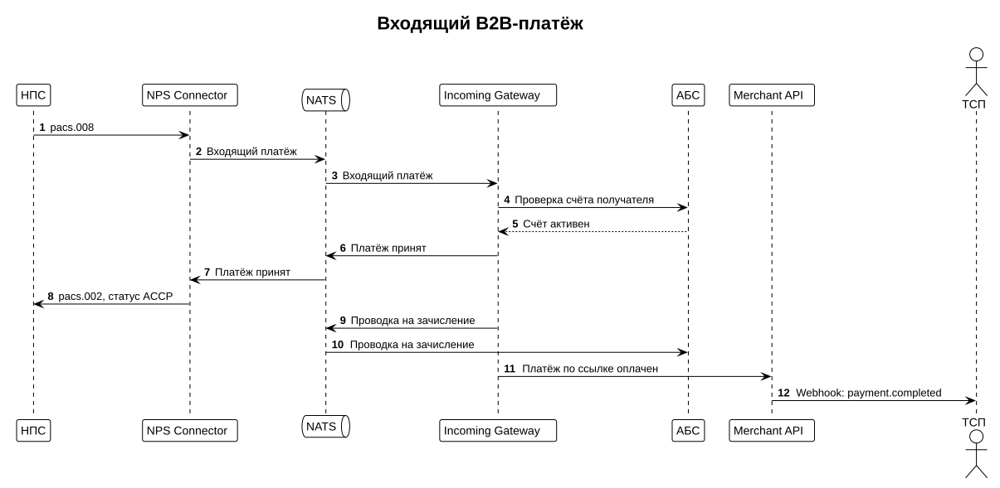

# Входящий платёж

Когда юридическое лицо (клиент другого банка) оплачивает платёжную ссылку вашего ТСП, платёж приходит из НПС, зачисляется на счёт ТСП, а ТСП получает уведомление.



## Уведомление ТСП

После зачисления Merchant API отправляет на адрес, указанный при подключении ТСП, webhook `payment.completed`:

```json
{
  "event": "payment.completed",
  "paymentId": "pay_8f3k2",
  "linkId": "lnk_2b9x7",
  "amount": 150000,
  "currency": "RUB",
  "payer": { "name": "ООО «Ромашка»", "inn": "7701234567" },
  "completedAt": "2026-10-15T12:34:56+03:00"
}
```

Webhook подписан: заголовок `X-Signature` содержит HMAC-SHA256 тела запроса на секрете ТСП. Секрет банк выдаёт при подключении ТСП вместе с `client_id`. Проверяйте подпись до обработки уведомления.

Ответьте `200 OK` в течение 5 секунд. Если ответа нет, Merchant API повторит отправку 5 раз с растущим интервалом: 1, 5, 15, 60 и 300 секунд.

!!! tip "Не полагайтесь только на webhook"
    Если уведомление не пришло, статус всегда можно получить запросом `GET /v1/payment-links/{linkId}`.
