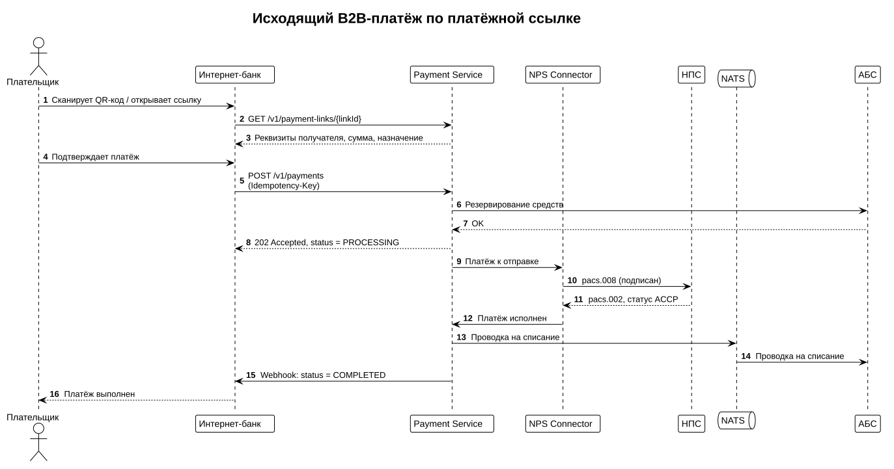
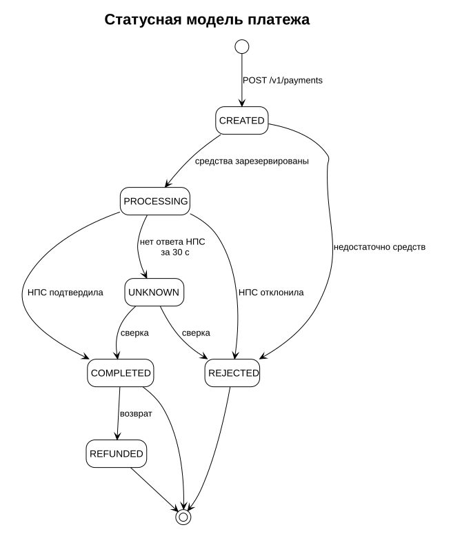

# Исходящий платёж

Плательщик (юридическое лицо) оплачивает счёт ТСП по QR-коду или платёжной ссылке из интернет-банка. Платёж проходит синхронную проверку и резервирование средств, а в НПС отправляется асинхронно, поэтому интернет-банк получает финальный статус через webhook.

## Шаги

1. Интернет-банк получает реквизиты ссылки, созданной ТСП, по её идентификатору: `GET /v1/payment-links/{linkId}`.
2. После подтверждения плательщиком интернет-банк создаёт платёж: `POST /v1/payments` с заголовком `Idempotency-Key`.
3. Payment Service резервирует средства в АБС и сразу отвечает `202 Accepted` со статусом `PROCESSING`.
4. Платёж отправляется в НПС. Когда НПС подтверждает его, Payment Service публикует проводку на списание, а интернет-банк получает webhook со статусом `COMPLETED`.

!!! note "Справочник API для интернет-банка"
    Методы Payment Service для интернет-банка в демонстрационный проект не входят. Они используют те же форматы статусов и ошибок, что и [Merchant API](api/merchant-api.md).

!!! warning "Повтор запроса"
    Если ответ на `POST /v1/payments` не получен (таймаут, обрыв связи), повторите запрос **с тем же** `Idempotency-Key`. Сервис вернёт уже созданный платёж, а не создаст второй. С новым ключом вы рискуете списать деньги дважды.

## Статусы платежа

| Статус | Финальный | Описание | Действие |
| --- | --- | --- | --- |
| `CREATED` | Нет | Платёж принят, средства ещё не зарезервированы. | Ждать. |
| `PROCESSING` | Нет | Средства зарезервированы, платёж отправлен в НПС. | Ждать webhook. |
| `UNKNOWN` | Нет | НПС не ответила за 30 секунд. Статус определится при сверке. | Не создавать новый платёж; запросить статус через 5 минут. |
| `COMPLETED` | Да | Платёж исполнен, средства списаны. | Показать плательщику успех. |
| `REJECTED` | Да | Платёж отклонён банком или НПС. Резерв снят. | Показать причину из поля `reason`. |
| `REFUNDED` | Да | По платежу выполнен полный возврат. | — |

После частичного возврата статус остаётся `COMPLETED`, а сумма всех возвратов отображается в поле `refundedAmount`.
