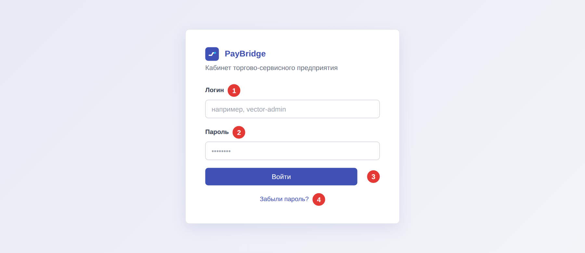

# Вход в кабинет

Инструкция для сотрудника ТСП, который выставляет счета юридическим лицам и следит за оплатами.

## Перед началом

Ссылку на кабинет и логин вам передаст администратор кабинета вашей компании. Временный пароль банк присылает на адрес электронной почты, который администратор указал при подключении.

## Как войти

*Рисунок 1. Страница входа*

1. Откройте в браузере ссылку на кабинет ТСП.
2. Введите логин в поле **Логин** (1).
3. Введите пароль в поле **Пароль** (2).
4. Нажмите кнопку **Войти** (3).

**Результат:** откроется раздел **Платёжные ссылки**.

## Если забыли пароль

Нажмите ссылку **Забыли пароль?** (4). На адрес электронной почты придёт письмо с инструкцией по смене пароля.

## Если что-то пошло не так

| Ситуация | Что делать |
| --- | --- |
| Появилось сообщение «Неверный логин или пароль» | Проверьте, правильно ли заполнены поля, какой выбран язык ввода и не включён ли Caps Lock. |
| Учётная запись заблокирована после нескольких попыток входа | Обратитесь к [администратору кабинета](index.md#куда-обращаться). |
| Письмо для восстановления пароля не пришло | Проверьте папку «Спам». Если письма нет, обратитесь к [администратору кабинета](index.md#куда-обращаться). |
