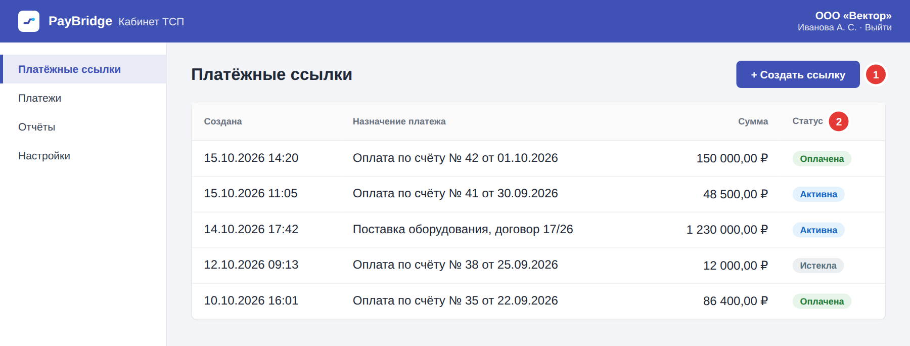
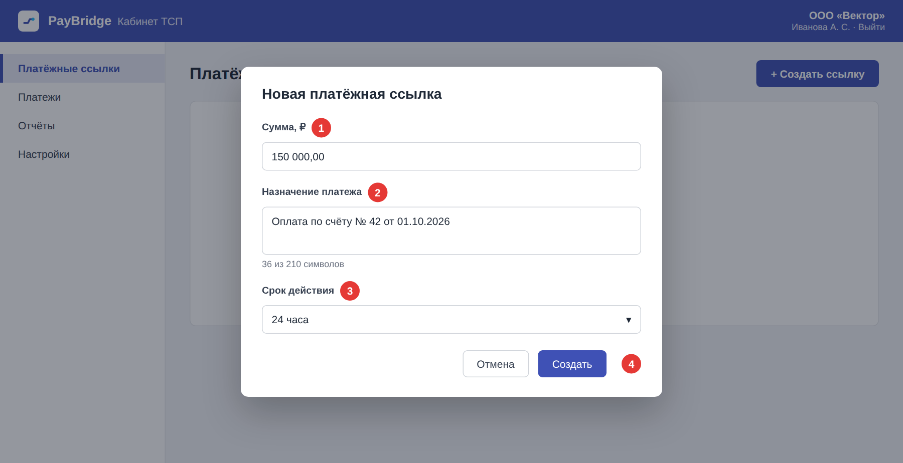
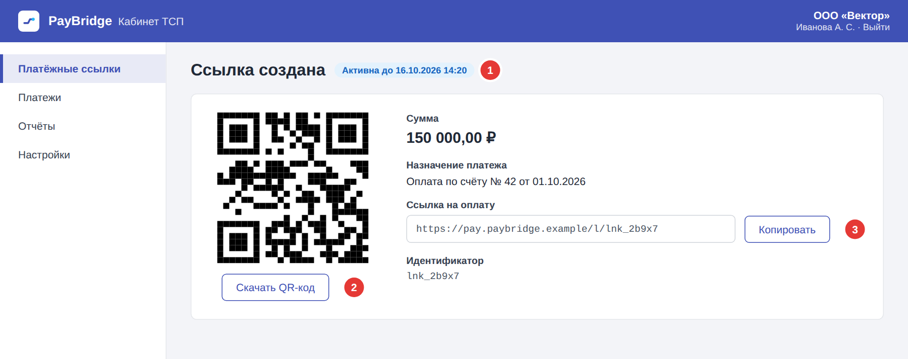

# Выставление счёта по ссылке

Кабинет ТСП предлагает два способа оплаты счёта: платёжную ссылку и QR-код. Покупатель, юридическое лицо, оплачивает счёт из своего интернет-банка.

- **Платёжная ссылка** — уникальный интернет-адрес, который открывает защищённую страницу оплаты.
- **QR-код** — изображение с данными платежа. Покупатель сканирует его в интернет-банке или камерой телефона.

## Как создать ссылку

*Рисунок 1. Раздел «Платёжные ссылки»*

1. В меню слева откройте раздел **Платёжные ссылки** и нажмите **Создать ссылку** (1).

*Рисунок 2. Форма новой ссылки*

2. Введите сумму в рублях и копейках в поле **Сумма** (1), например *150 000,00*.
3. Заполните поле **Назначение платежа** (2). Обычно здесь указывают номер и дату счёта. Максимальная длина — 210 символов.
4. Выберите **Срок действия** (3) ссылки: *15 минут*, *1 час*, *12 часов* или *24 часа*. По умолчанию выбрано *24 часа*. По истечении срока ссылка перестаёт действовать.
5. Нажмите кнопку **Создать** (4).

## Как отправить ссылку покупателю

*Рисунок 3. Созданная ссылка*

Откроется страница созданной ссылки. Вверху указаны статус и срок действия (1), ниже QR-код, сумма, назначение платежа и ссылка на оплату.

- Чтобы скачать QR-код, нажмите **Скачать QR-код** (2). QR-код можно вставить в счёт или документ либо отправить покупателю.
- Чтобы скопировать ссылку, нажмите **Копировать** (3). Ссылку можно отправить покупателю, например по электронной почте.

## Статусы ссылки

Статус ссылки показан в колонке **Статус** (2) на рисунке 1.

| Статус | Что означает | Что делать |
| --- | --- | --- |
| Активна | Ссылка создана и ждёт оплаты. | Отправьте ссылку или QR-код покупателю и дождитесь оплаты. |
| Оплачена | Покупатель оплатил счёт по ссылке. | Данные платежа можно посмотреть в разделе **Платежи**. |
| Истекла | Срок действия ссылки истёк, оплатить по ней нельзя. | Создайте новую ссылку. |

## Если что-то пошло не так

| Ситуация | Что делать |
| --- | --- |
| Кнопка **Создать** неактивна | Проверьте, что заполнены поля **Сумма** и **Назначение платежа**. Если кнопка всё ещё неактивна, обновите страницу. Если не помогло, обратитесь к [администратору кабинета](index.md#куда-обращаться). |
| Покупатель сообщает, что ссылка не открывается | Проверьте статус ссылки. Если срок действия истёк, создайте новую ссылку. Если ссылка активна, проверьте, что покупатель получил её целиком, или отправьте QR-код. |
| Покупатель оплатил, а ссылка всё ещё в статусе «Активна» | Подождите несколько минут и обновите страницу. Если статус не изменился, обратитесь к [администратору кабинета](index.md#куда-обращаться). |
