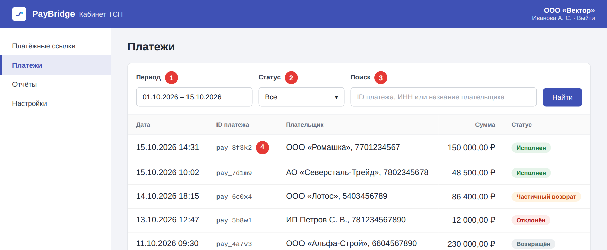
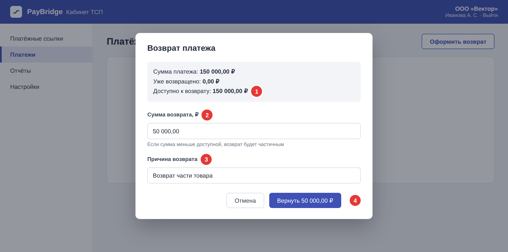

# Поиск платежа и возврат

Возврат нужен, если сделка отменена: покупатель отказался от товара или услуги, платёж ошибочный или договор расторгнут. Можно вернуть всю сумму платежа или её часть.

## Как найти платёж

*Рисунок 1. Раздел «Платежи»*

1. В меню слева откройте раздел **Платежи**.
2. Выберите **Период** (1).
3. При необходимости выберите **Статус** (2) платежа.
4. Если известны ID платежа, ИНН или название плательщика, введите их в поле **Поиск** (3). Нажмите **Найти**.
5. В таблице нажмите ID нужного платежа (4). Откроется карточка платежа.

## Статусы платежа

| Статус | Что означает | Можно ли вернуть |
| --- | --- | --- |
| Исполнен | Платёж проведён. | Да |
| Частичный возврат | Платёж проведён, часть суммы уже возвращена. | Да, в пределах оставшейся суммы |
| Возвращён | Платёж проведён, вся сумма возвращена. | Нет |
| Отклонён | Платёж не проведён. | Нет |

## Как оформить возврат

*Рисунок 2. Окно возврата*

1. В карточке платежа нажмите **Оформить возврат**.
2. Проверьте сумму, доступную к возврату (1). Если по платежу уже был частичный возврат, она меньше суммы платежа.
3. Введите **Сумму возврата** (2): полную или меньше для частичного возврата.
4. В поле **Причина возврата** (3) кратко укажите причину. Покупатель увидит её в уведомлении о поступлении средств.
5. Нажмите кнопку подтверждения (4). На кнопке указана сумма возврата, проверьте её перед нажатием.

**Результат:** статус платежа изменится на **Возвращён** или **Частичный возврат**. Деньги поступят покупателю в течение трёх рабочих дней.

!!! warning "Возврат нельзя отменить"
    После нажатия кнопки подтверждения возврат отправляется в банк, и отменить его нельзя. Перед подтверждением проверьте сумму на кнопке.

## Если что-то пошло не так

| Ситуация | Что делать |
| --- | --- |
| Кнопки **Оформить возврат** нет в карточке платежа | Проверьте статус платежа в таблице выше. Если возврат возможен, а кнопки нет, обратитесь к [администратору кабинета](index.md#куда-обращаться). |
| Появилось сообщение «Сумма возврата превышает доступную» | Уменьшите сумму возврата до доступной или меньше. |
| Возврат долго находится в обработке | Подождите несколько минут и обновите страницу. Если статус не изменился, обратитесь к [администратору кабинета](index.md#куда-обращаться). |
